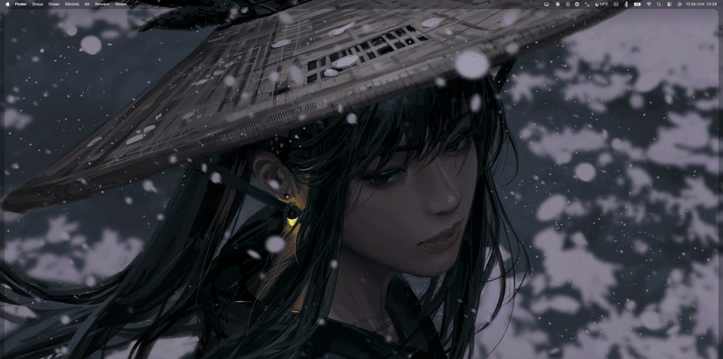

# NotchBlack

<p align="center">
  
</p>

<p align="center">
  <a href="LICENSE"></a>
  
  
  
  
</p>

macOS notch'unu (ve/veya menü çubuğunu) siyaha boyayan, minimum kaynak tüketen, native bir araç.

TopNotch gibi uygulamaların yerine geçmek için yazıldı — duvar kağıdına bağımlı kalmadan, tamamen AppKit pencere katmanı üzerinden çalışır. Bu yüzden macOS sürüm güncellemelerine (TopNotch'un macOS 27'de bozulduğu gibi) karşı daha dayanıklıdır.

## Özellikler

- Notch'lu ve notch'suz (harici) her ekranda çalışır
- Monitör takma/çıkarma, uyku/uyanma ve Spaces geçişlerinde otomatik güncellenir — polling yok, tamamen olay tabanlı
- Menü çubuğu simgesinden ekran başına veya topluca aç/kapat
- Girişte otomatik başlatma (`SMAppService`)
- [Hammerspoon](https://www.hammerspoon.org/) ile kontrol edilebilir: distributed notification ve `notchblack://` URL scheme üzerinden `refresh` / `on` / `off` / `toggle` / `status` komutları
- Boşta ~0% CPU, ~18 MB RAM

## Kurulum

Xcode'a gerek yok, sadece Command Line Tools yeterli:

```bash
xcode-select --install   # zaten kuruluysa atla
```

```bash
git clone https://github.com/<kullanici-adin>/notchblack.git
cd notchblack
./build.sh
```

Derleme bitince uygulamayı kalıcı olarak kullanmak için `/Applications`'a kopyala:

```bash
cp -R build/NotchBlack.app /Applications/
open /Applications/NotchBlack.app
```

Menü çubuğundaki simgeden "Girişte Başlat"ı açabilirsin.

> `build.sh` her çalıştığında `build/` klasörünü siler. Geliştirme sırasında orada test edebilirsin, ama kalıcı kurulum için her zaman `/Applications`'taki kopyayı güncel tut.

## Kullanım

Menü çubuğundaki simgeye tıkla:

- **Bu Ekranda Aç/Kapat** — şu an aktif olan ekran için
- **Tüm Ekranlarda Aç/Kapat**
- **Girişte Başlat**
- **Çıkış**

## Hammerspoon entegrasyonu

Kendi `init.lua`'nda ekran değişimi gibi görevleri NotchBlack ile zincirlemek istersen `examples/hammerspoon-example.lua` dosyasına bak. Özetle:

```lua
local NB = "local.notchblack"

local function notchblack(cmd, display)
    local running = hs.application.get("NotchBlack") ~= nil
    if running then
        hs.distributednotifications.post(NB .. ".command", nil, { cmd = cmd, display = display or "all" })
    else
        hs.urlevent.openURL(string.format("notchblack://%s?display=%s", cmd, display or "all"))
    end
end

notchblack("refresh")
```

NotchBlack işini bitirince `local.notchblack.didRefresh` bildirimini yayınlar, bunu dinleyerek bir sonraki adımı tetikleyebilirsin.

## Nasıl çalışır

Her ekran için, menü çubuğunun hemen altına (bir seviye altına) siyah, tıklanamaz (`ignoresMouseEvents`), tüm Spaces'lere katılan bir pencere yerleştirilir. Menü çubuğu öğeleri bu pencerenin üzerinde kalır ve tıklanabilir durumda kalır.

Bilinen sınırlama: Ekranın fiziksel yuvarlak köşe yarıçapını resmi bir API olmadan birebir yakalamak mümkün değil, bu yüzden bar bilinçli olarak düz dikdörtgen bırakıldı. Çok yakından bakıldığında köşelerde 1-2 piksellik, neredeyse görünmeyen bir boşluk kalabilir — bu, API'siz çalışan benzer araçların (TopNotch dahil) paylaştığı bilinen bir durum.

## Lisans

MIT — bkz. [LICENSE](LICENSE).
